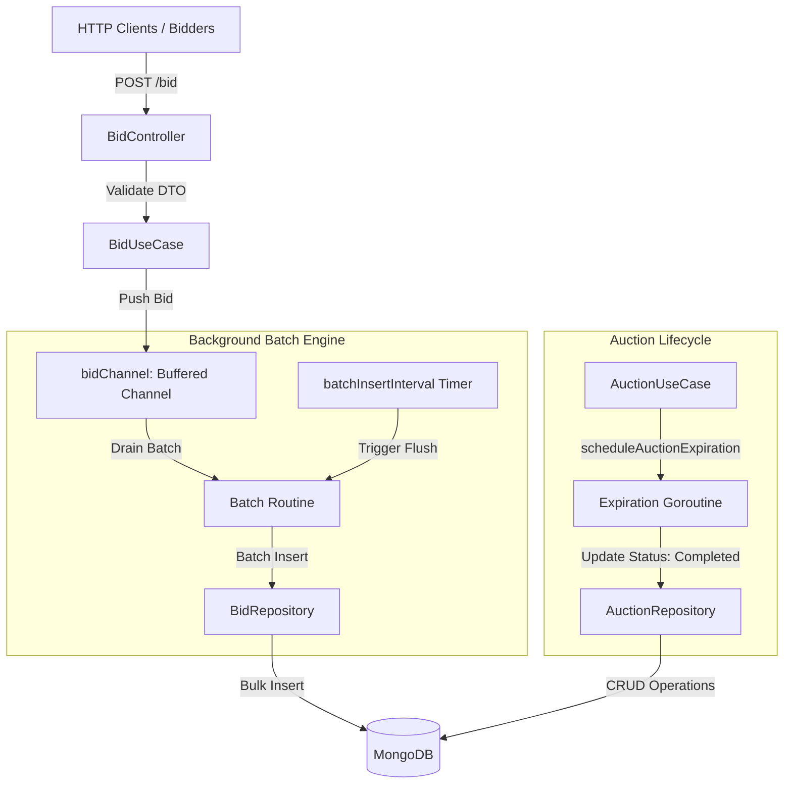
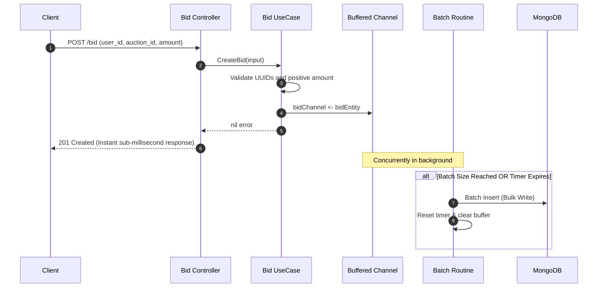

# Distributed Auction System in Go

## Purpose

A high-concurrency auction engine written in Go and backed by MongoDB. The system is designed to handle extreme bid traffic spikes during real-time auctions without overwhelming the database. It achieves this by decoupling synchronous HTTP bid acceptance from persistence using Go channels and adaptive batching routines.

- **Buffered Asynchronous Ingestion:** Bids are validated and queued into in-memory buffered channels, returning immediate `201 Created` responses to clients.
- **Batch Flusher Worker:** A background worker flushes queued bids to MongoDB in batches either when `MAX_BATCH_SIZE` is reached or upon `BATCH_INSERT_INTERVAL` timer expiration.
- **Lifecycle Expiration:** Automated auction lifecycle management where active auctions automatically complete after their configured `AUCTION_INTERVAL`.
- **Winning Bid Resolution:** Instant determination of the winning bid using indexed MongoDB descending amount queries.

## Technologies

- **Go 1.23**
- **Gin Web Framework** — REST HTTP routing and payload validation
- **MongoDB Go Driver** — Official BSON document store driver
- **MongoDB 7.0** — Primary document store
- **Zap Logger** — High-performance structured logging
- **Docker & Docker Compose** — Multi-arch containerization with automated health checks

## Architecture



## Execution flow



1. **Validation & Enqueue:** Incoming bid requests validate user UUID, auction UUID, and bid amount. Once validated, the bid is sent into a buffered Go channel (`bidChannel`), allowing HTTP handlers to respond immediately.
2. **Background Batching:** A dedicated goroutine selects across `bidChannel` and `timer.C`. When the accumulated batch reaches `MAX_BATCH_SIZE`, or when `timer.C` fires, the worker executes a single bulk write against MongoDB.
3. **Auction Lifecycle:** When an auction is created via `POST /auctions`, the system schedules a lifecycle timer. Upon reaching `AUCTION_INTERVAL`, the status automatically transitions from `Active` (`0`) to `Completed` (`1`).

## Running it

Start the service and MongoDB database with Docker Compose:

```bash
docker compose up --build -d
```

- App Server: `http://localhost:8080`
- MongoDB Port: `27017`

Configurable environment variables (via Docker or `.env`):
- `MONGODB_URL`: MongoDB connection URI (default `mongodb://mongodb:27017`)
- `MONGODB_DB`: Database name (default `auctions`)
- `BATCH_INSERT_INTERVAL`: Timer interval to flush batches (e.g., `100ms`, `3m`)
- `MAX_BATCH_SIZE`: Threshold count to trigger batch writes (default `20`)
- `AUCTION_INTERVAL`: Lifetime of an active auction (default `5m`)

## Testing

Run unit tests with Go's race detector enabled:

```bash
go test -race -v ./...
```

Included tests cover:
- Automatic expiration timing and auction status transitions (`TestAuctionAutomaticExpiration`)
- Channel-based batch accumulation and timeout-triggered flushing (`TestBidBatchProcessing`)
- Winner determination and highest-bid retrieval
- User repository lookups and error handling

## Metrics

Load tested on Apple Silicon with [`hey`](https://github.com/rakyll/hey) with 50 concurrent workers (`-c 50`) over 10-second sustained traffic windows:

```bash
hey -z 10s -c 50 -m POST -H "Content-Type: application/json" \
  -d '{"user_id":"a0a12131-dbbd-4896-a48f-6e60e418760a","auction_id":"...","amount":999.99}' \
  http://localhost:8080/bid
```

| Endpoint | req/sec | avg latency | p50 | p90 | p99 |
|---|---:|---:|---:|---:|---:|
| `POST /bid` (Buffered Async Ingestion) | **8,110** | 6.2 ms | 5.8 ms | 8.4 ms | 13.3 ms |
| `GET /auctions` (List Active Auctions) | **11,040** | 4.5 ms | 3.6 ms | 7.9 ms | 16.7 ms |
| `GET /auction/winner/{id}` (Find Highest Bid) | **163** | 304.4 ms | 301.6 ms | 370.5 ms | 445.6 ms |

### Key Observations
- **Throughput Decoupling:** Ingesting bids asynchronously through channel buffers delivers over **8,100 req/sec** sustained at p99 latency under **14ms**, protecting MongoDB from single-row insertion lock contention.
- **Read vs. Ingestion Tradeoff:** Under high unindexed write load, querying `FindWinningBidByAuctionID` scans the collection for the highest bid. Indexing `{auction_id: 1, amount: -1}` reduces sort overhead and brings winner queries in line with primary index lookups.

## Tradeoffs

### Buffered Batching vs. Immediate Write Consistency
- **Buffered Batching (Adopted):** Decouples client latency from database I/O, allowing massive concurrency during the final seconds of an auction. Bids are guaranteed to reach the channel buffer before HTTP returns 201.
- **Immediate Consistency Alternative:** Directly writing each bid synchronously ensures instant read-after-write consistency but creates database connection pool exhaustion and throttles throughput under load.

### In-Memory Goroutine Timers vs. Distributed Scheduler
- **Goroutine Timers (Adopted):** Simple, zero-dependency lifecycle expiration per node using standard Go concurrency primitives.
- **Distributed Job Runner Alternative:** For multi-replica deployments behind a load balancer, using a distributed task scheduler (e.g., Redis keyspace notifications or MongoDB TTL indexes) ensures lifecycle expiration survives individual instance restarts.

## Endpoints

| Method | Path | Description |
|---|---|---|
| `POST` | `/auctions` | Create a new auction (`product_name`, `category`, `description`, `condition`) |
| `GET` | `/auctions` | Query auctions (optional query params: `status`, `category`, `productName`) |
| `GET` | `/auctions/:auctionId` | Fetch auction details by UUID |
| `POST` | `/bid` | Submit a bid (`user_id`, `auction_id`, `amount`) |
| `GET` | `/bid/:auctionId` | List all bids placed on an auction |
| `GET` | `/auction/winner/:auctionId` | Return auction details and winning highest bid |
| `GET` | `/user/:userId` | Query user by UUID |

## Project Layout

```
cmd/
  auction/
    main.go                   # Dependency injection and HTTP route registration
configuration/
  database/mongodb/           # MongoDB client initialization and ping health check
  logger/                     # Zap logger configuration
  rest_err/                   # Standardized REST error formats
internal/
  entity/
    auction_entity/           # Domain entity and validation rules
    bid_entity/               # Bid entity and UUID/amount validation
    user_entity/              # User entity
  infra/
    api/web/controller/       # Gin HTTP handlers
    database/                 # MongoDB repository adapters
  usecase/
    auction_usecase/          # Auction business logic and lifecycle expiration
    bid_usecase/              # Batch processing and highest bid calculation
    user_usecase/             # User lookup logic
```
